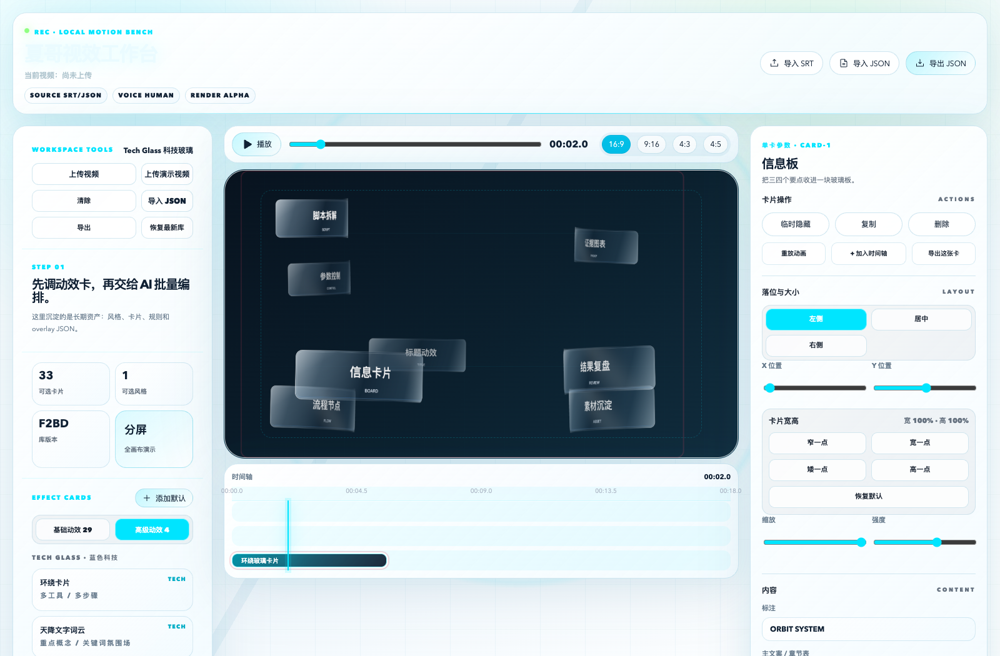
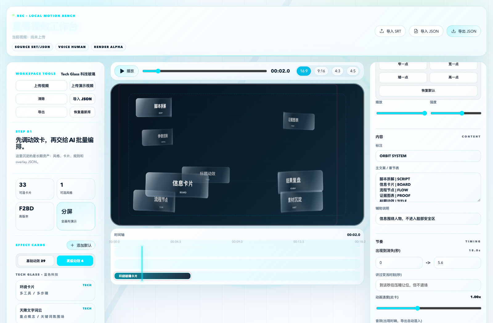
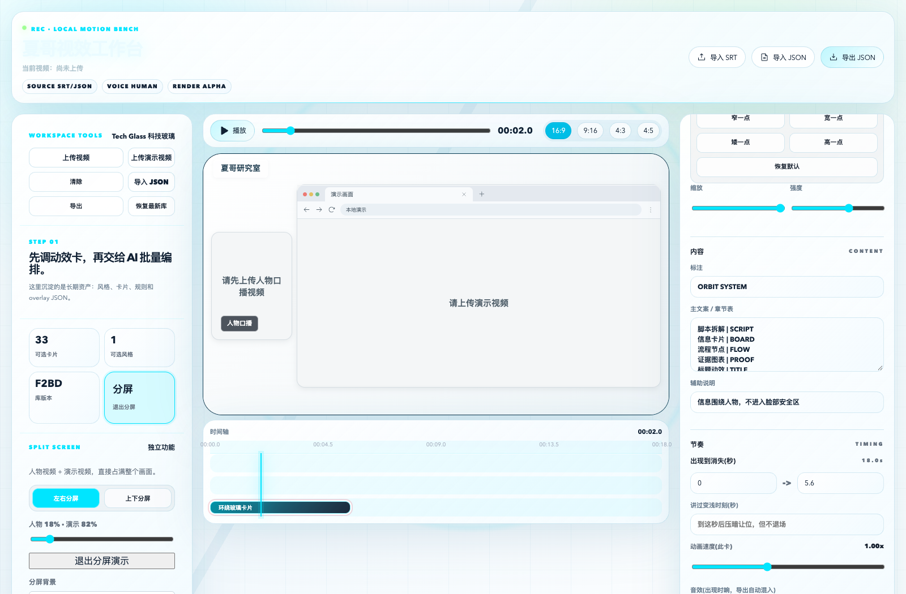

# 夏哥视效工作台 | XiaGe Motion Workbench

**为口播视频编排可复用的动效，在本地预览和调整。**

**Arrange reusable motion graphics for talking-head videos. Preview and edit locally.**

macOS · Node.js 22+ · 私有试用 / Private Preview



## 这是用来做什么的？ | What is it for?

夏哥视效工作台是一套本地运行的网页工具，面向口播、教程和产品讲解视频的创作者。它把反复制作的标题、数字、步骤和重点短语沉淀为可编辑动效卡，让你在同一个工作台里安排时间、修改文字、调整位置，并预览与口播视频叠加的效果。

XiaGe Motion Workbench is a local web app for creators making talking-head videos, tutorials, and product explainers. It turns recurring titles, numbers, steps, and key phrases into editable motion cards. Arrange their timing, edit copy, adjust placement, and preview them over your footage in one workspace.

**它不是完整剪辑软件，也不是输入一句话就自动输出成片的云服务。** 本仓库同时提供产品源码和配套 AI Skill：前者是工作台，后者教 AI 如何帮助你安装、编排和扩展它。

**It is not a full video editor or a prompt-to-video cloud service.** This repository includes both the app source and a companion AI Skill: the app provides the workspace; the Skill guides an AI assistant through setup, planning, and extension.

## 主要能力 | Main Capabilities

| 功能 | 中文说明 | English |
| --- | --- | --- |
| 本地预览 / Local preview | 导入自己的口播视频，查看叠加效果 | Load your own footage and preview overlays locally. |
| 动效卡库 / Motion library | 基础与高级动效，包含标题、数字、步骤和环绕卡片 | Reusable basic and advanced cards for titles, numbers, steps, and orbiting panels. |
| 字幕与编排 / Subtitle planning | 导入中文 SRT，或导入 AI 审阅后生成的 JSON | Import Chinese SRT subtitles or a reviewed JSON plan prepared with AI. |
| 参数编辑 / Editing | 调整文案、位置、大小、颜色和节奏 | Edit copy, placement, dimensions, colors, and timing. |
| 多画幅 / Aspect ratios | 16:9、9:16、4:3、4:5 | Preview four supported canvas formats. |
| 分屏预览 / Split screen | 左侧口播、右侧演示，可调整占比和背景 | Preview talking-head and demo footage together, with adjustable proportions and backgrounds. |
| 编排保存 / Save plans | 导出 JSON，方便继续调整和复用 | Export JSON plans for later editing and reuse. |

## 产品截图 | Product Screenshots

以下图片来自真实分享版工作台，使用示例词组，无私人视频。界面目前为中文；本页提供中英文说明，不代表应用已支持英文界面。

These are actual screenshots of the shared preview build, using sample text and no private footage. The app UI is currently Chinese; this bilingual README does not imply an English UI is available.

### 文字、大小与节奏编辑 | Copy, Size, and Timing

在右侧面板编辑当前卡片，在播放器下方的时间轴检查出现和结束时间。

Edit the selected card in the right panel and review its timing on the timeline below the player.



### 独立分屏布局 | Split-Screen Layout

小窗口保留人物，大窗口展示演示内容。下图为**未上传两路视频时的布局预览**，不是已经生成的成片。

A smaller pane holds the speaker while a larger pane presents the demonstration. The screenshot shows **the layout before either video has been uploaded**, not a rendered final video.



## 快速开始 | Quick Start

1. 安装 Node.js 22 LTS 或更新版本。 / Install Node.js 22 LTS or newer.
2. 下载仓库并解压到非 iCloud 目录，例如 `~/Developer/xiage-motion-workbench`。 / Download the repository into a non-iCloud folder, such as `~/Developer/xiage-motion-workbench`.
3. 在仓库根目录运行以下命令。 / Run this command from the repository root:

```bash
bash start.command
```

首次启动会联网安装依赖、构建并打开浏览器。保持终端打开，完成后按 Control+C 停止服务；后续仍运行同一命令。

The first launch downloads dependencies, builds the app, and opens your browser. Keep the terminal open; press Control+C to stop the server. Use the same command on subsequent launches.

这是 macOS 源码试用包，不是已签名的桌面安装器。启动使用空闲本机端口，不停止其他服务。端口变化会隔离浏览器存储，所以请主动导出 JSON，重新打开后导入编排并选择视频。

This is a macOS source preview, not a signed desktop installer. The launcher uses an available local port without stopping other services. Browser storage is isolated by port, so export your JSON plans and reimport them, along with your footage, when reopening on a different port.

## 推荐工作流 | Suggested Workflow

**上传口播 → 选择画幅 → 导入 SRT / JSON → 检查时间轴与人物安全区 → 调整卡片 → 导出 JSON。**

**Load footage → Select aspect ratio → Import SRT / JSON → Review timing and subject-safe areas → Adjust cards → Export JSON.**

重要视频建议先让 AI 根据完整 SRT 做语义分割并列出规划表，确认后再导入 JSON。自动规则只是起点，长文字、人物位置和动画节奏仍需实际预览。

For important projects, have your AI assistant group the complete SRT into semantic sections and propose a planning table before importing JSON. Automated rules are a starting point; review long text, subject placement, and pacing against your actual footage.

## 配套 Skill | Companion Skill

入口：[skills/xiage-motion-workbench/SKILL.md](skills/xiage-motion-workbench/SKILL.md)。将所在文件夹安装到 AI 工具支持的 Skills 目录，并告诉 AI 仓库的位置；也可以直接让 AI 阅读该文件。

Entry point: [SKILL.md](skills/xiage-motion-workbench/SKILL.md). Install its folder into your AI tool's supported Skills directory and tell the assistant where this repository is located, or ask it to read the file directly.

Skill 包含安装、使用、字幕语义编排和新增卡片的指导，不自带模型服务、账号或算力。工作台默认本地读取视频；但将素材发送给云端 AI 前，请确认所用工具的数据政策。

The Skill covers setup, daily use, semantic subtitle planning, and adding cards. It does not include a model service, account, or compute. The app reads footage locally by default, but check your AI provider's data policy before sending media to a cloud assistant.

## 当前边界 | Current Limitations

| 中文 | English |
| --- | --- |
| 未随包提供透明 MOV 渲染器或完整分屏 MP4 合成器。JSON 是编排文件，不是视频。 | No transparent MOV renderer or full split-screen MP4 compositor is included. JSON is a plan, not a video. |
| 分屏功能当前用于预览，不自动生成右侧演示视频。 | Split screen currently provides preview; it does not generate demonstration footage automatically. |
| APP 背后环绕因图标和分割模型许可待核实而停用。 | Behind-subject app-icon orbit is disabled pending asset and segmentation-model licensing checks. |
| 自动安全区不等于人物检测，卡片仍可能需要手动调整。 | Automatic safe zones are not subject detection; manual adjustments may be necessary. |
| 已完成本机干净安装、构建和基础界面检查，完整实片回归与第二台 Mac 测试待完成。 | Clean installation, build, and basic UI checks passed locally; full footage regression and testing on a second Mac remain pending. |

验收记录：[ACCEPTANCE.md](docs/ACCEPTANCE.md) · 第三方边界：[THIRD_PARTY.md](docs/THIRD_PARTY.md)。这些补充文档目前为中文。

See the [acceptance checklist](docs/ACCEPTANCE.md) and [third-party notes](docs/THIRD_PARTY.md). These supporting documents are currently in Chinese.

## 访问与授权 | Access and Licensing

当前仅限获邀私有试用，未授予公开再分发或商业许可。第三方依赖继续受各自许可证约束。

Access is currently limited to invited private testers. No permission for public redistribution or commercial use is granted. Third-party dependencies remain subject to their respective licenses.
